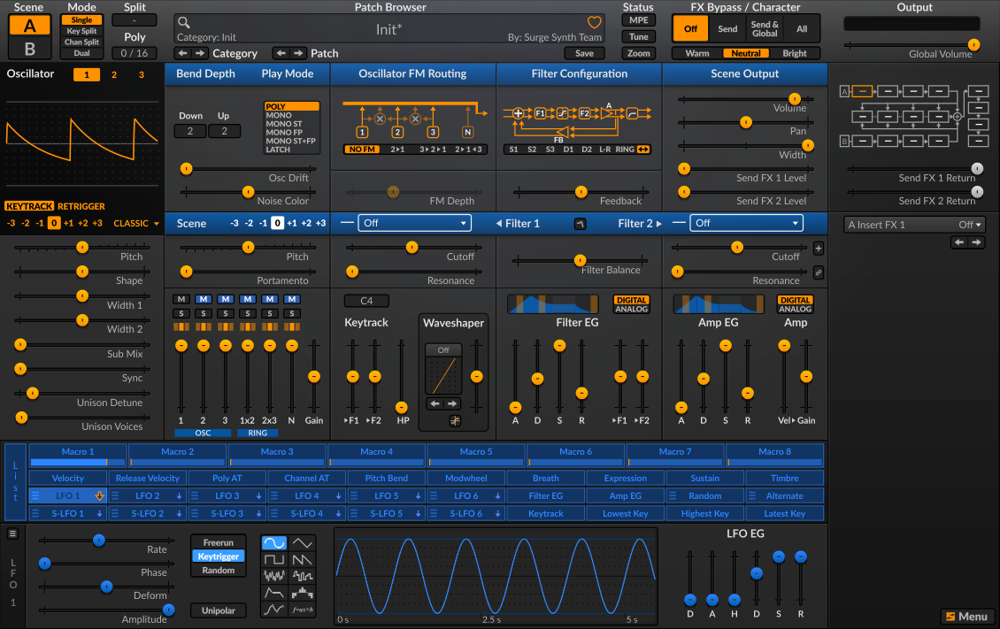
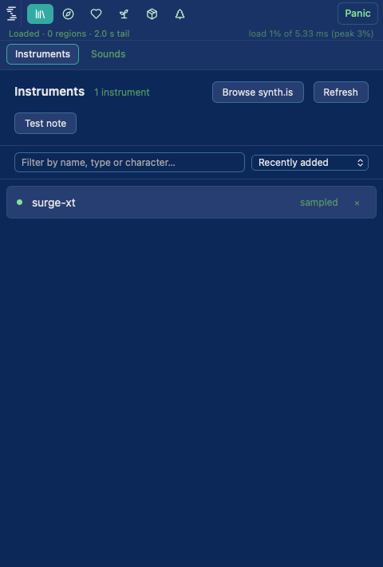

# The engine's own interface inside the plugin editor (synthis-et4.4)

Run 2026-10-27, unattended, on the Mac Studio. Surge XT only. Code: `src/WclapEngineView.{h,cpp}`,
the GUI half of `src/WclapEngine.{h,cpp}`, `PluginEditor` (`syncEngineView`, `resized`), and the
probe `tools/wclap-host-probe` (sections 6, 6b, 6c). Builds only with `-DSYNTHIS_WCLAP_HOST=ON`;
the shipping build is unchanged (the gate does not compile any of it).

## Verdict

**The protocol is carried with no change to the bundle and none to the bridge.** Surge XT's own
editor draws inside the plugin editor, a knob moved in it reaches the engine, `clap.state` and the
processor's session blob. This was OBSERVED (screenshots of the real WKWebView, checks below), not
inferred. What was NOT observed is listed at the end; read it before relying on this.

## How it works

- The page is the bundle's `ui/` (`index.html`, `ui.js`, `ui.wasm` 20.5 MB, `factory/` 62 MB read
  lazily by the page). It runs in a `juce::WebBrowserComponent` (WKWebView) whose **resource
  provider serves only files under `<bundle>/ui/`** (traversal, `%2e%2e` and `module.wasm` refused,
  probe-checked). Navigation off the provider's scheme is refused. Native integration is on, but
  the only things registered are two event listeners (`wclapFrame`, `wclapDebug`): no native
  function.
- The guest is opened in the CLAP gui API `"webview"` (`clap.gui` create, no native window, no
  parent). `get_uri` first (`/ui/index.html`), then `create`, then the protocol of
  `juce_webclap_protocol.h` flows as `clap.webview` frames: `receive` (page to engine) and the
  host extension `send` (engine to page). The host now answers `request_callback`
  (`on_main_thread` on the message thread), so the guest's page updates are sent from the message
  thread rather than from its audio-thread fallback inside `process()`.
- **The adapter is a 40-line script injected before the page** (`kShim`). In a top-level webview
  `window.parent === window`, so the page's `window.parent.postMessage(ArrayBuffer)` is
  `window.postMessage`; the shim catches it and emits a JUCE event with base64. Inbound frames are
  delivered as `MessageEvent{data: ArrayBuffer, source: window}`.
- The editor gives the page a rectangle off the **right** of the editor (a native webview cannot be
  overlapped); the shell, with the plugin's own macro controls, keeps the rest (minimum 480 px).
  The editor grows to fit when the page reports its size.

## Why not the bridge's own webview (`webview-gui`)

Read from the bridge source at the pinned revision, NOT run:

1. `get_uri` returns the relative `/ui/index.html`; the bridge then serves resources by asking the
   guest's `get_resource`, and juce_webclap's answer is `false` ("hosts serve the bundle"). Only a
   `file:` URI makes the bridge serve from disk. So the bundle's page would 404.
2. `WebviewGui::send` builds `new MessageEvent('message', {data})` with no `source`, and
   `webclap-ui.js` drops every message whose `source !== window.parent`. Every engine-to-page
   frame (snapshot, parameter updates) would be lost.
3. Its `Uint8Array.fromBase64` polyfill allocates `b64.length` bytes, not the decoded length (trailing
   zeros on every frame).

None of these needs a bridge patch for us (we bypass the module), but (2) and (3) are bugs for any
host that uses it: `docs/WCLAP_BRIDGE_UPSTREAM_ISSUE.md` is the place to add them.

## Measurements (macOS 26, Apple Silicon, Release, this Mac Studio)

| | |
|---|---|
| Editor size with Surge XT | **1610 x 711** = shell 480 + page 1130 x 711 |
| Editor size before the engine view | 1280 x 800 (resizable, min 640 x 400) |
| The guest's own `get_size` says | 904 x 569, which is **wrong**: the page's canvas is 1130 x 711 and a 904 x 569 view clips it (screenshot 1 in this run). The page says its real size in a `resize` frame about 0.7 s after start; the editor fits to that. |
| Editor creation (`createEditor`) | 80 ms |
| Engine view open to page loaded | 78 to 565 ms (5 runs) |
| Open to UI module up (`ready`) | **333 to 835 ms** (5 runs; the first after a rebuild was the slowest) |
| `ui.wasm` init inside the page | 76 to 82 ms |
| First frames painted | within 2 s (the paint summary is once a second: 806k pixels in the first three frames) |
| Resource provider reading 22.8 MB from disk | 57 to 87 ms |
| Frames, page to engine, for one open | 3 (hello, a 64-type, resize) |
| Frames, engine to page, first 7 s | about 46 to 68 (snapshot 67.9 KB, then parameter echoes) |
| Engine side, hello to snapshot | 77 to 90 ms; snapshot carries 775 parameters and the 58,603-byte state |

The 20 MB module is NOT the cost one fears: WebKit compiled and ran it in about 0.3 to 0.8 s here.
A first open on a machine that has never run this wasm (no WebKit compile cache) was not measured.

## Checks (`wclap_host_probe surge-xt`, 38 PASS, 0 FAIL; exit 0)

Headless protocol (section 6): the gui opens as `webview`; hello accepted; snapshot arrives with
775 params and the state; a `param` frame for the first writable knob changes the engine's CLAP
value (0.8 to 0.1, linear expectation 0.1), changes the saved `clap.state`, and changes the
processor's session blob (what a DAW project keeps); host automation of another parameter comes
back as a `param` frame; a `resize` frame is accepted; nothing is accepted after `guiClose`; the
provider's file rules.

Real webview (6b, `KROMOSYNTH_PROBE_WEBVIEW=60 KROMOSYNTH_PROBE_DRAG=1`): the page loads, the UI
module becomes ready, frames paint, and **synthetic pointer events dragging Surge's Oscillator
Pitch slider** send 3 `param` frames and a gesture, change the engine's saved state and the session
blob, and the second screenshot shows the slider moved with Surge's own "0.36 semitones" read-out.
Full editor (6c, `KROMOSYNTH_PROBE_EDITOR=8`): `createEditor`, the engine view appears by itself,
the editor refits to 1610 x 711.

Run: see `docs/PLUGIN_WCLAP_HOST_SPIKE.md` "Reproduce"; add the `KROMOSYNTH_PROBE_*` variables above
(`_SNAPSHOT=<png>` and `_EDITOR_SNAPSHOT=<prefix>` write WKWebView snapshots; the 6b drag
coordinates are for this exact bundle).

## NOT observed (do not read these as working)

- **The plugin editor inside a DAW** (AU in Live/Logic, VST3 in Reaper). Everything above ran
  `createEditor()` in the probe's own process, on the desktop, with no host. Host-specific window
  handling, the AU view lifecycle, and resizing from the host side were not seen.
- **A real mouse and a real keyboard.** The drag used synthetic `PointerEvent`s with
  `setPointerCapture` stubbed (a synthetic pointer id has none). Real pointer capture, wheel,
  text entry in Surge's fields, and keyboard focus in a plugin window were not tried.
- **Retina / pixel ratio 2.** The page reported `dpr 1`. Not seen at 2.
- **A screen narrower than 480 + 1130.** The editor is clamped to the display, which then clips the
  page's right edge (the output section). No scaling is done. Not seen on a laptop screen.
- **Audio from the page's "Test"/preview paths**, MIDI from the page's keyboard (`midi` frame),
  preset browsing that reads the lazy `factory/` files (it did not log any `factory/` request in
  these runs because nothing opened a browser).
- **Closing and reopening the editor in one session**, switching instruments while the page is
  open (designed: the view is rebuilt when the guest instance changes; not exercised), two
  instances in one process.
- **Saving the project and reopening** with the page open. The headless session-blob check covers
  the data, not the editor.
- Windows, Linux, iOS (no Wasmtime JIT there anyway).
- The AU/VST3 binaries were built (they link); neither was loaded in a host.

## Fallback parameter view: cost, if the page ever fails

Not built; the page works. `WclapEngine` already exposes `numParams` / `paramInfo` /
`paramValue` / `queueParam` (775 parameters for Surge XT, many hidden or modulator slots). A native
generic view needs: a searchable list with groups (Surge names carry their section, "A Osc 1 ..."),
a slider per parameter writing through `queueParam`, and polling or `clap.params` flush to follow
the engine. About a day for a usable list, and it would give up everything that makes Surge Surge
(the wavetable and oscillator displays, the FX routing, the patch browser, modulation drawing).
There is also no way to reach patch loading from it except through `clap.state`.

## Decisions

- Own `WebBrowserComponent` rather than the bridge's native GUI: see above.
- The shim lives in the host, not in the bundle: the bundle stays byte-identical, and any other
  kit-built WCLAP (Six Sines, OB-Xf, Odin 2, RipplerX use the same page protocol) should work the
  same way; only Surge XT was tried.
- The editor rebuilds the view when `WclapEngine::generation()` changes rather than patching it.
- `KROMOSYNTH_WCLAP_UI=0` turns the view off (the engine plays, the shell is as before).
- Probe-only objective-C++ (`WebViewSnapshot.mm`) takes the screenshots; it is not in the plugin.
